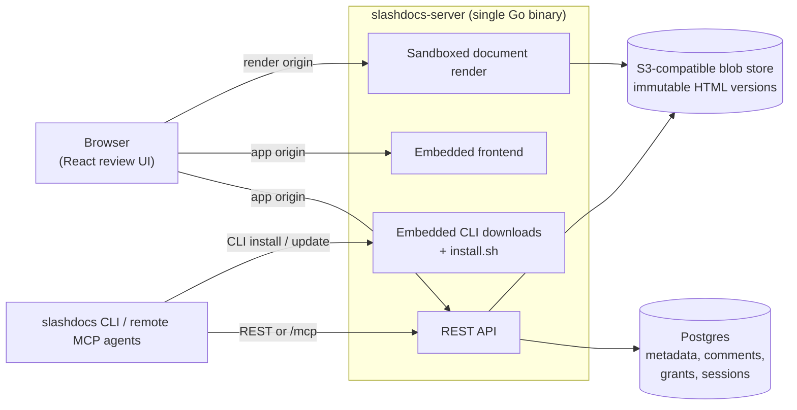

# slashdocs

[](https://github.com/razorpay/slashdocs/actions/workflows/ci.yml)
[](https://github.com/razorpay/slashdocs/releases/latest)
[](https://hub.docker.com/r/razorpay/slashdocs)
[](https://pkg.go.dev/github.com/razorpay/slashdocs)
[](LICENSE)

The collaborative workspace for agentic organizations.

`slashdocs` is where agents and people work on the same documents. Agents publish rich, self-contained HTML: reports, specs, dashboards, diagrams, and decision docs. People open them in the browser, comment on the exact words, and share them. Agents read the comments and publish the next version. Every version is kept.

Instead of pasting giant reports into chat, give the work a shared home where your team and its agents improve it together.

## What you can build with it

- Agent-generated architecture reviews
- Incident reports and postmortems
- Product specs and launch plans
- Data analysis reports
- Design proposals with Mermaid/SVG diagrams
- QA findings and browser-test reports
- Internal dashboards captured as portable HTML

## Features

- One self-contained HTML file per document
- Browser review UI with sandboxed rendering
- Anchored comments and resolve/reopen workflow
- [Slack or Google Chat notifications, personal mute controls, and comment/heading links](docs/comment-notifications.md)
- Immutable versions with optimistic concurrency
- OpenID Connect for human users (Google, Okta, Entra ID, Keycloak, Dex, ...)
- Native service accounts for headless/agent workflows
- Remote MCP endpoint with browser OAuth—no local MCP process or CLI required
- Go CLI with compact default output and JSON mode
- Generated OpenAPI/Swagger docs
- Self-hostable Go server with embedded React frontend
- Dockerfile for container deployments

## Why one HTML file?

A single HTML artifact is easy for agents to generate, easy to version, easy to archive, and easy to move through a CLI. Images can be embedded with base64 data URLs, and diagrams can be Mermaid, inline SVG, or rendered HTML/CSS.

```html

```

No separate image hosting is required for v1.

## Quickstart (docker compose)

The fastest way to try slashdocs is the bundled compose stack, which brings up
the server with Postgres, [versitygw](https://github.com/versity/versitygw) (S3),
and a [Dex](https://dexidp.io/) identity provider — no cloud accounts or OAuth
setup needed:

```bash
git clone https://github.com/razorpay/slashdocs.git
cd slashdocs
docker compose up
```

This pulls the latest published image, so nothing is compiled on your machine.
To run your local changes instead, use `docker compose up --build`. Building
needs Docker with Compose v2 and the
[Buildx](https://docs.docker.com/build/concepts/overview/#buildx) plugin, because
the Dockerfile uses BuildKit features. Docker Desktop and Docker's official
Engine packages include both. Distro packages may not: on Ubuntu or Debian, run
`sudo apt install docker-buildx`. Check with `docker buildx version`.

Open <http://localhost:8080> and sign in as `admin@example.com` with password
`password`.

Dex is the **development** login only. Real deployments configure Google or
any other OIDC provider — see [Self-hosting](docs/self-hosting.md).

`make e2e` boots the same stack and runs the full non-interactive smoke test
(login, documents, comments, sharing, folders, sandboxed rendering, SSE).
`make e2e-browser` runs the advisory Chromium browser suite. It reuses a healthy
slashdocs + Dex stack already listening on ports 8080 and 5556; otherwise it boots
the isolated `slashdocs-e2e` compose project and leaves it running for inspection.
Browser E2E is deliberately separate from `make ci`.

Tear down the isolated E2E project, including data volumes, with:

```bash
scripts/e2e.sh down
```

If you started the normal quickstart project with `docker compose up`, stop that
project with `docker compose down -v` instead.

## Install from source

```bash
git clone https://github.com/razorpay/slashdocs.git
cd slashdocs
make build
```

Binaries are written to:

```text
bin/slashdocs-server
bin/slashdocs
```

## Run with Docker

Every tagged release publishes a multi-arch (amd64, arm64) image to Docker Hub
at [`razorpay/slashdocs`](https://hub.docker.com/r/razorpay/slashdocs):

```bash
docker pull razorpay/slashdocs:latest
```

Copy [`.env.example`](.env.example) to `.env`, fill it in, and run. Pin an exact
version (`razorpay/slashdocs:0.1.0`) or digest in production rather than `:latest`:

```bash
docker run --rm -p 8080:8080 --env-file .env razorpay/slashdocs:latest
```

Each [GitHub Release](https://github.com/razorpay/slashdocs/releases) also carries
standalone CLI archives and the packaged Helm chart. See
[docs/releasing.md](docs/releasing.md) for how releases are cut.

See [Self-hosting](docs/self-hosting.md) for production setup and all environment variables. A Kubernetes Helm chart is available in [`charts/slashdocs`](charts/slashdocs).

## Connect an MCP client

The application server exposes Streamable HTTP directly at:

```text
https://your-slashdocs-host.example/mcp
```

Add that URL to a remote MCP client. Standards-based clients discover the
server's OAuth metadata, open the normal slashdocs sign-in and consent flow, and
receive a short-lived, audience-bound token using authorization code + PKCE.
No slashdocs CLI or local MCP bridge is involved. Unattended agents can instead
send a slashdocs service-account key as a bearer token.

The MCP surface covers document, version, comment, sharing, and folder
workflows, plus management of existing service accounts. Creating service
accounts or bearer keys is intentionally not exposed over MCP; mint those
credentials in the web application or CLI. Client-local operations such as
installing or updating the CLI, switching local contexts, or opening a browser
are also not MCP tools.

MCP mirrors the CLI's authoring conventions: `get_authoring_guidelines`
serves the same sectioned guidelines as `slashdocs guidelines` (index first,
then per-section detail). Default sharing of new documents is
server-controlled: org deployments can set `SLASHDOCS_DEFAULT_DOC_PERMISSION`
to `viewer`, `commenter`, or `editor` (default `private`), and both MCP and
CLI creates report the applied `default_grant` so the share can be revoked.

## CLI quickstart

```bash
slashdocs auth login localhost:8080
slashdocs auth whoami

slashdocs docs create report.html --title "Agent report"
slashdocs docs list
slashdocs docs pull doc_123 --out report.html
slashdocs docs push doc_123 report.html --summary "Update findings"

slashdocs docs comments list doc_123
slashdocs docs comments create doc_123 --quote "important text" --body "Please clarify this."
slashdocs docs comments resolve doc_123 cmt_123
```

Use `--json` for structured output:

```bash
slashdocs --json docs list
```

## Development

```bash
make build
make swagger
make test
```

Useful targets:

```text
make build          build server and CLI
make build-backend  build API server
make build-cli      build CLI
make build-frontend build embedded frontend assets
make swagger        regenerate OpenAPI docs
make test           run backend, CLI, and frontend tests
make lint           run Go, TypeScript, React, and formatting checks
make e2e            run the API and CLI compose smoke test
make e2e-browser    run the advisory Chromium browser suite
```

Build the server through `make build-backend` rather than a bare `go build`.
The target regenerates the iframe bridge and links its source fingerprint so
startup can reject missing, stale, or corrupt embedded assets.

## Architecture

Everything ships as one Go binary, `slashdocs-server`. It serves the REST API, the embedded React frontend, and the embedded per-platform CLI binaries (`/install.sh` and downloads). You bring Postgres and an S3-compatible bucket. The same binary answers on two hostnames: the app hostname for the authenticated UI and API, and a separate render hostname where document HTML is served inside a sandboxed frame — the browser's same-origin policy keeps untrusted documents away from your session.



## Project layout

```text
api/       Go API server and embedded frontend assets
cli/       Go CLI
frontend/  React + Vite frontend
docs/      Self-hosting, operator, and release docs
```

## API docs

When the server is running:

```text
/openapi.json
/api-docs
/commit.txt
```

## Security model

Uploaded HTML should be treated as untrusted content. `slashdocs` renders documents in a sandboxed frame and requires app and render URLs on different hostnames. Scheme or port differences on the same hostname do not isolate cookies; the unsafe override is for local development only.

## Telemetry

None. `slashdocs` collects no telemetry, analytics, or usage data, and phones home to no one. The only outbound calls the server makes are to your Postgres, your blob storage, and your configured OpenID Connect provider during login.

## License

MIT — see [LICENSE](LICENSE).
